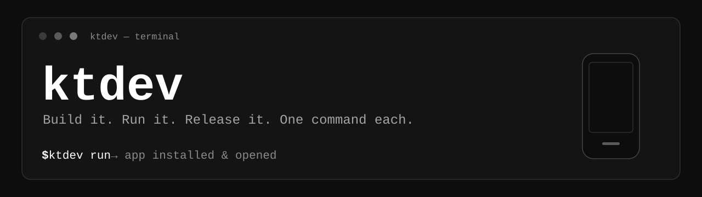
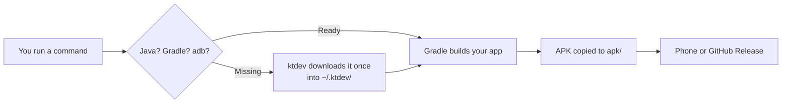
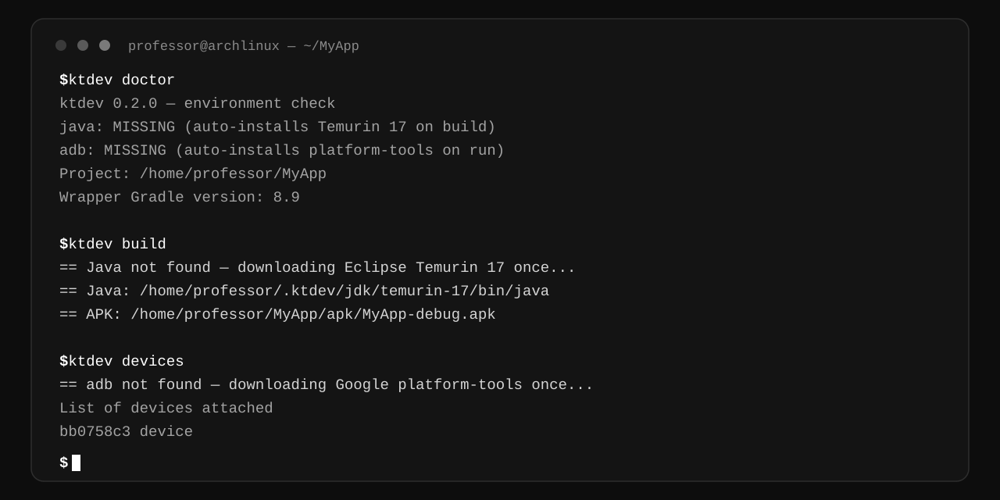
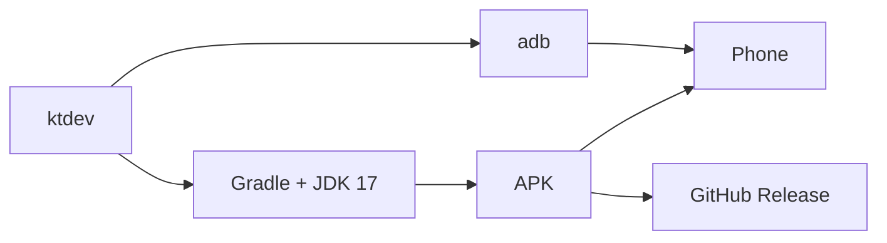

<div align="center">



[](https://github.com/masudibnbelat/ktdev-cli/releases)
[](https://github.com/masudibnbelat/ktdev-cli/actions)
[](https://go.dev/)
[](https://github.com/masudibnbelat/ktdev-cli/releases)
[](https://github.com/masudibnbelat/ktdev-cli/releases)
[](https://github.com/masudibnbelat/ktdev-cli/stargazers)

[](https://github.com/masudibnbelat/ktdev-cli/pulls)
[](https://github.com/masudibnbelat/ktdev-cli/commits/main)
[](https://github.com/masudibnbelat/ktdev-cli/issues)

**One small CLI for any Android project.**
Build it. Run it on your phone. Release it on GitHub. One command each.

[](https://github.com/masudibnbelat/ktdev-cli)

[](https://github.com/masudibnbelat/ktdev-cli)

</div>

---

## Contents

- [Why ktdev?](#why-ktdev)
- [See how it works](#see-how-it-works)
- [See it in action](#see-it-in-action)
- [ktdev vs doing it by hand](#ktdev-vs-doing-it-by-hand)
- [1. User Guide](#1-user-guide)
  - [1.1 Installation Process](#11-installation-process)
  - [1.2 Usage](#12-usage)
  - [1.3 Command List](#13-command-list)
  - [1.4 How It Works](#14-how-it-works)
- [2. Developer Guide](#2-developer-guide)
- [Contributing](#contributing)
- [Changelog](#changelog)
- [Troubleshooting](#troubleshooting)
- [What ktdev does NOT do](#what-ktdev-does-not-do)

---

## Why ktdev?

| | |
|---|---|
| **Any Android project** | Kotlin or Java — it makes no difference. `ktdev` never reads your source code. It only runs Gradle and talks to `adb`. |
| **No setup fights** | Java, Gradle, and `adb` install themselves when they are missing. No Android Studio needed for them. |
| **Right Gradle, every time** | The version comes from your own project. Gradle 8.9 in one project, 8.5 in another — `ktdev` uses the right one. It never uses the wrong Gradle from `PATH`. |
| **APK where you can find it** | Every build also copies the APK to `MyApp/apk/MyApp-debug.apk` (or `-release.apk`). No digging through `app/build/outputs/apk/`. |
| **Safe releases** | A release stops on a dirty tree, checks the APK version matches the tag, and never uploads the wrong version. |
| **Small and fast** | One binary, about 6 MB. Written in Go, standard library only — no dependencies. |

> [!NOTE]
> **Runs on your computer only — Windows, Linux, or macOS.**
> It does **not** run on your phone. Your phone is only used to install
> and open the app. `build` and `release` do not need a phone at all.

---

## See how it works



---

## See it in action

A fresh computer — no Java, no `adb`, no Gradle installed. Just `ktdev`:



The same session as text:

```
$ ktdev doctor
ktdev 0.2.0 — environment check
java: MISSING (auto-installs Temurin 17 on build)
adb: MISSING (auto-installs platform-tools on run)
gh: /usr/bin/gh
---
Project: /home/professor/MyApp
Wrapper Gradle version: 8.9
Gradle: /home/professor/MyApp/gradlew

$ ktdev build
== Java not found — downloading Eclipse Temurin 17 once...
== Java: /home/professor/.ktdev/jdk/temurin-17/bin/java
== Gradle: /home/professor/MyApp/gradlew
== APK: /home/professor/MyApp/apk/MyApp-debug.apk

$ ktdev devices
== adb not found — downloading Google platform-tools once...
== adb: /home/professor/.ktdev/platform-tools/adb
List of devices attached
bb0758c3	device
```

First time only — next builds reuse the saved copies, in under a second.

---

## ktdev vs doing it by hand

| Step | By hand | With ktdev |
|---|---|---|
| Install Java | Download a JDK, set `JAVA_HOME`, fix the version | Automatic on first build |
| Install adb | Download platform-tools, add it to `PATH` | Automatic on first run |
| Pick the Gradle version | Read the wrapper file, find a matching install | Automatic, from your project |
| Find the APK | Dig through `app/build/outputs/apk/` | Copied to `apk/` for you |
| Make a release | Tag, build, check the version, push, `gh release create` | One command: `ktdev release v1.5.0` |

---

## 1. User Guide

### 1.1 Installation Process

Follow these steps in order. Nothing else is needed.

**Step 1 — Run the install command for your computer.**

Linux / macOS — paste this in a terminal:

```bash
curl -fsSL https://raw.githubusercontent.com/masudibnbelat/ktdev-cli/main/install.sh | bash
```

Windows — paste this in PowerShell:

```powershell
irm https://raw.githubusercontent.com/masudibnbelat/ktdev-cli/main/install.ps1 | iex
```

**Step 2 — Close the terminal and open it again.**

This loads the new `ktdev` command. Without this step, your
terminal still uses the old setup.

**Step 3 — Check that it works.**

```bash
ktdev --version
```

You should see `ktdev 0.2.0` (or newer).

**Step 4 — Check your setup.**

```bash
ktdev doctor
```

Example output:

```
ktdev 0.2.0 — environment check
ANDROID_HOME: /home/professor/Android/Sdk
java: /usr/bin/java (system)
adb: /home/professor/Android/Sdk/platform-tools/adb (system)
gh: /usr/bin/gh
gradle: /home/professor/.local/opt/gradle-9.3.1/bin/gradle
---
List of devices attached
bb0758c3	device
Project: /home/professor/MyApp
Wrapper Gradle version: 8.9
Gradle: /home/professor/MyApp/gradlew
```

**Step 5 — Know what you need first.**

| Need | For |
|---|---|
| Android SDK (Android Studio installs it) | Building |
| `git` | `release` |
| `gh` (GitHub CLI, `gh auth login` once) | `release` only |
| A phone with USB debugging on | `run`, `devices`, `logs`, `uninstall` |

> [!TIP]
> Java and `adb` are **not** in this list — `ktdev` installs them itself
> when they are missing. See [1.4 How It Works](#14-how-it-works).

---

### 1.2 Usage

<table align="center">
  <tr>
    <td align="center" width="33%">
      <br>
      <b>Build</b><br>
      No phone needed
    </td>
    <td align="center" width="33%">
      <br>
      <b>Run</b><br>
      Phone needed
    </td>
    <td align="center" width="33%">
      <br>
      <b>Release</b><br>
      No phone needed
    </td>
  </tr>
</table>

Every use starts the same way: go into your Android project folder
first.

```bash
cd MyApp
```

#### Use 1 — Build only (no phone needed)

**Step 1 —** Go into your project folder (`cd MyApp`).

**Step 2 —** Run:

```bash
ktdev build
```

**Step 3 —** Find your APK here (the original stays where Gradle put it):

```
MyApp/apk/MyApp-debug.apk
```

For a release build, use `ktdev build --release` instead.
That makes `MyApp/apk/MyApp-release.apk`.

#### Use 2 — Build + install on your phone (phone needed)

**Step 1 —** Connect your phone by USB and turn on USB debugging.

**Step 2 —** Go into your project folder (`cd MyApp`).

**Step 3 —** Run:

```bash
ktdev run
```

**Step 4 —** `ktdev` builds the app, installs it on your phone,
and opens it. The APK is also copied to
`MyApp/apk/MyApp-debug.apk`
(or `MyApp-release.apk` with `ktdev run --release`).

If you have two phones connected, pick one:

```bash
ktdev run --device bb0758c3
```

#### Use 3 — Build + GitHub release (no phone needed)

**Step 1 —** Go into your project folder (`cd MyApp`).

**Step 2 —** Run:

```bash
ktdev release v1.5.0 "Fixed percent bug"
```

**Step 3 —** `ktdev` does everything for you, in order:

1. Makes the tag `v1.5.0`
2. Builds the release APK
3. Checks the APK version matches the tag
4. Copies the APK to `MyApp/apk/MyApp-release.apk`
5. Pushes the code and the tag to GitHub
6. Creates the GitHub Release with the APK

No phone needed. You need internet and `gh auth login` done once.

> [!TIP]
> To see what will happen, without doing it:
>
> ```bash
> ktdev release --dry-run
> ```
>
> To release the next patch version without typing a number:
>
> ```bash
> ktdev release
> ```
>
> `v1.4.2` becomes `v1.4.3`.

---

### 1.3 Command List

| Command | What it does | Phone needed? |
|---|---|---|
| `ktdev run [--clean] [--device SERIAL] [--release]` | Build, install on your phone, open it | **Yes** |
| `ktdev build [--release] [--clean]` | Build only, copy APK to `apk/` | No |
| `ktdev release [v1.5.0] ["notes"] [--major\|--minor\|--dry-run\|--yes]` | Tag, build, check version, push, GitHub Release | No |
| `ktdev devices` | List connected phones | Yes |
| `ktdev logs` | Live logcat for your app | Yes |
| `ktdev uninstall` | Uninstall your app from the phone | Yes |
| `ktdev clean` | Gradle clean | No |
| `ktdev doctor` | Check SDK, Java, adb, Gradle, project | No |
| `ktdev --help` | Show help | No |
| `ktdev --version` | Show version | No |

---

### 1.4 How It Works



<details>
<summary><b>Gradle — picked from your project, never hardcoded</b></summary>

`ktdev` reads the version from your own project:

```
gradle/wrapper/gradle-wrapper.properties
```

Order:

1. `./gradlew` in your project (the wrapper downloads its own Gradle).
2. A local install of that exact version
   (`~/.local/opt/gradle-<version>`, the wrapper cache, or `~/.ktdev/gradle/`).
3. If it is nowhere, `ktdev` downloads that exact version once
   to `~/.ktdev/gradle/gradle-<version>/`.

The Gradle on `PATH` is never used as a fallback when the wrapper
wants a different version — that is the bug that broke AGP 8.x
projects with Gradle 9.x.

</details>

<details>
<summary><b>Java — Temurin 17, only when you need it</b></summary>

- You already have Java 17–21? `ktdev` uses yours. Nothing downloads.
- No Java, or the wrong version? On the first build, `ktdev` downloads
  Eclipse Temurin 17 once (about 190 MB) to `~/.ktdev/jdk/`
  (`%USERPROFILE%\.ktdev\jdk\` on Windows) and sets `JAVA_HOME`
  for Gradle. Next builds use the saved copy.

</details>

<details>
<summary><b>adb — Google platform-tools, only when you need it</b></summary>

- `adb` already on your computer? `ktdev` uses it. Nothing downloads.
- No `adb`? On the first `run`, `devices`, `logs`, or `uninstall`,
  `ktdev` downloads Google's platform-tools once (about 10–15 MB)
  to `~/.ktdev/platform-tools/`
  (`%USERPROFILE%\.ktdev\platform-tools\` on Windows).

</details>

<div align="right">

[Back to top ↑](#contents)

</div>

---

## 2. Developer Guide

You want to change `ktdev` itself? You only need Go 1.23 or newer.
Follow these steps in order. Everything is copy-paste.

**Step 1 — Get the code.**

```bash
git clone https://github.com/masudibnbelat/ktdev-cli.git
cd ktdev-cli
```

**Step 2 — Change the code.**

Edit any `.go` file. When you get changed files from someone,
put them in this folder and replace the old ones.

**Step 3 — Build and install, in one command.**

Linux / macOS:

```bash
go build -o ktdev . && cp ktdev ~/.local/bin/ktdev && ktdev --version
```

Windows (PowerShell):

```powershell
go build -o ktdev.exe .; Copy-Item ktdev.exe "$env:LOCALAPPDATA\ktdev\bin\ktdev.exe" -Force; ktdev --version
```

That one command builds it, installs it, and shows the new version.
If it shows the old version, close the terminal and open it again.

**Step 4 — Test it.**

```bash
ktdev doctor
```

Then test the command you changed, for example `ktdev build`
in a test Android project.

**Step 5 — Release a new version.**

First, change the version number in `main.go`
(`const version = "0.2.0"`). Then run this:

```bash
git add -A
git commit -m "v0.2.0: what changed"
git push
git tag v0.2.0
git push origin v0.2.0
```

> [!WARNING]
> Tag only **after** you pushed the latest code — the tag must be on
> the newest commit, or the Release will build old code.

After the push, GitHub Actions builds the Release by itself.
Before you tell anyone to install, check the Release page has
files named `ktdev-linux-amd64` and `ktdev-windows-amd64.exe`
(no `.tar.gz` / `.zip`).

<div align="right">

[Back to top ↑](#contents)

</div>

---

## Contributing

Found a bug, or want a new command? Contributions are welcome.
Follow these steps:

**Step 1 —** Fork the repo on GitHub, then clone your fork:

```bash
git clone https://github.com/YOUR-NAME/ktdev-cli.git
cd ktdev-cli
```

**Step 2 —** Make a new branch for your change:

```bash
git checkout -b my-change
```

**Step 3 —** Change the code, then build and test it
(see [2. Developer Guide](#2-developer-guide), Steps 3–4).

**Step 4 —** Commit with a clear message:

```bash
git add -A
git commit -m "Add ktdev logs --follow"
```

**Step 5 —** Push and open a pull request on GitHub.
Write what you changed and how you tested it.

> [!TIP]
> Keep it small: one change per pull request, and keep the code
> standard-library only — no new dependencies.

---

## Changelog

| Version | What changed |
|---|---|
| **v0.2.0** | Java + adb auto-install (Temurin 17, Google platform-tools); `doctor` reports without downloading |
| **v0.1.0** | First release: `build`, `run`, `release`, `devices`, `logs`, `uninstall`, `clean`, `doctor`; dynamic Gradle; APK copy to `apk/` |

---

## Troubleshooting

| Problem | Fix |
|---|---|
| `no Android project found` | Go into your project folder first (`cd MyApp`) |
| `no phone found` | Connect the phone, turn on USB debugging, run `adb devices` |
| First build downloads Java | Normal, only once (about 190 MB). Next builds use the saved copy. |
| First `run` downloads adb | Normal, only once (about 10–15 MB). |
| First build downloads Gradle | Normal, only once. It downloads your project's exact Gradle version. |
| `tag v1.5.0 already exists` | Use a new version number |
| `Working tree is not clean` | Commit your changes first, or add `--yes` |
| `gh is not logged in` | Run `gh auth login` once |
| `APK stamp mismatch` | Do not upload it. Check the tag and version, then try again. |

---

## What ktdev does NOT do

- **It does not install the full Android SDK.** Java and `adb` install
  themselves, but building still needs the SDK (platforms +
  build-tools). Install Android Studio once for that.
- **It does not work with Flutter or React Native directly.** Their
  project layout is different. Running inside their `android/`
  folder may build, but release naming will be wrong. `ktdev` is
  for native Android (Kotlin/Java) projects.
- **It does not run on your phone.** It runs on Windows, Linux,
  or macOS only.

---

<div align="center">

Made with Go — standard library only, no dependencies.

If ktdev saves you time, give it a star ⭐ — it helps others find it.

</div>
